+++
date = '2026-10-31T18:11:29Z'
draft = false
title = 'Exynos: Tokyo Tsunami'
+++

This post will demonstrate the efforts my team ([Me](/steakhouse/) [Daniel Kethily](https://github.com/kethily-daniel) [Igor Belwon](https://github.com/BotchedRPR) [David Virag](https://github.com/VDavid003) and [Ion Agorria](https://github.com/IonAgorria)) took to reverse engineer an Exynos iROM exploit, leverage it and defeat secure boot on Exynos devices.

During this time, I got to learn a lot about Exynos SoCs, their IP and firmware, so please strap in for the ride.

## The beginning

During the early days of August 2025, I got a DM from one of my friends; little did I know opening it would be the equivalent of opening Pandora's box.

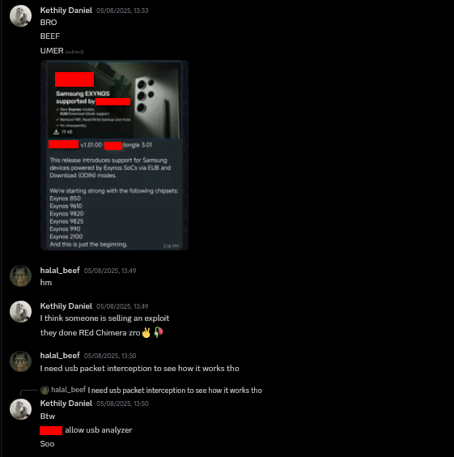

###### (yes I did censor the company we sniffed, this is mostly because they're not deserving of our attention, the exploit is stolen from Chimera and for servicing Samsung devices, you should go for them)

After receiving that DM, we immediately got to work. We proceeded to use various USB packet interception utilities to intercept the packets going out of the PC and into the device. Once we were happy with that, it was onto analysis.

### Analysis

This is where the rest of the team assembled, and for good reason; this was probably the most exhausting and complex step we took.

There are thousands of transfers, way too big to fit into this blog post, so I've only included a taste.

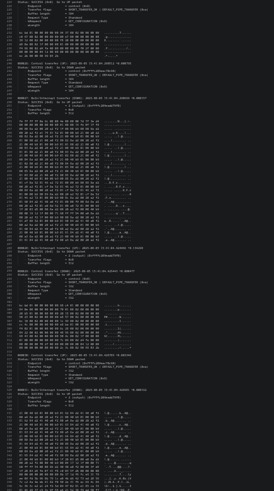
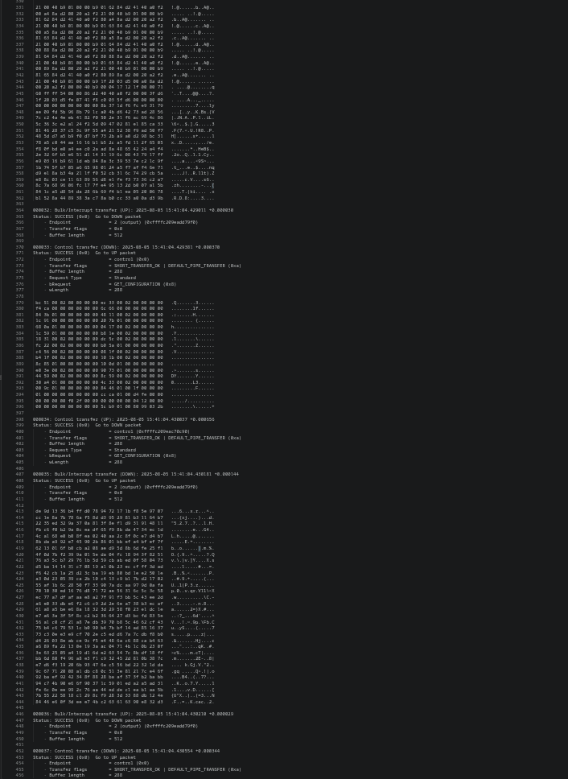
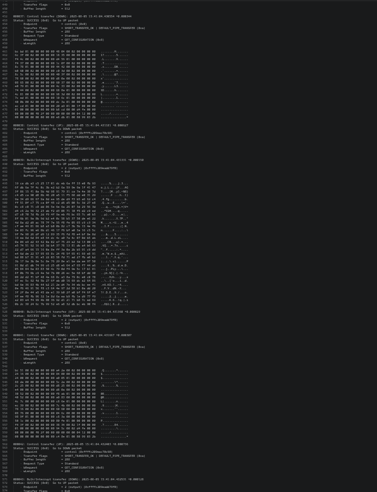

After a certain point, the device sent a response which obviously wasn't the standard response from Samsung's firmware.

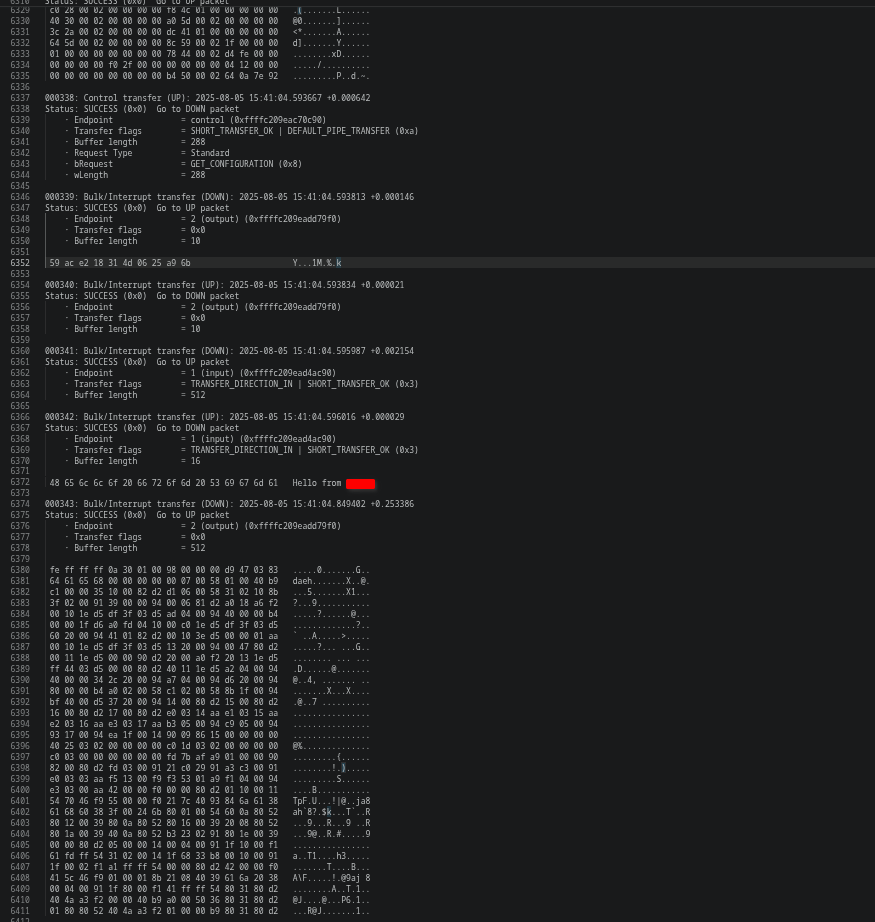

I personally couldn't make much sense of the packets as I hadn't delved into USB that much at this point, though I knew it was sending a payload with size 0x9C0A (so the file was 0x9C00 bytes long), sending random transfers and then sending the rest of the (strangely encrypted) firmware.

Anyone with a keen eye may have noticed the control transfers; there were a lot of them and they seem very large, a perfect candidate for exploitation. We didn't understand the exploit premise at this point, so we didn't understand the control transfers and what they were doing, so we knew the exploit had *something* to do with those control transfers, but we didn't understand the premise yet. But before we got carried away, Igor got to work replaying USB communication so that we could at least keep triggering the exploit and play around and attempt to understand the premise.

With lots of trial and error, we got our first reply from packet replaying.

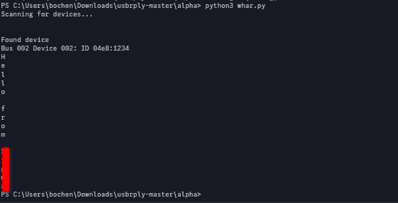

After that, though, we wanted to move this progress into a codebase that is more familiar to us, so we decided to attempt replaying using a tool based on [hubble](https://github.com/halal-beef/hubble), a tool I made to recover Exynos devices from a hardbrick, which worked perfectly.

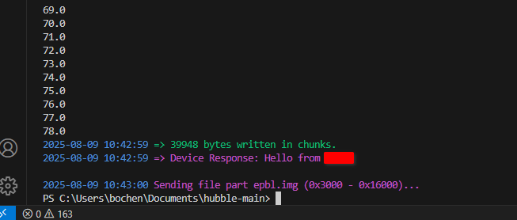

After that, Igor spent the next couple of days with Ion's help on figuring out what actually triggered the exploit, as we knew deep down it couldn't need a billion control transfers; it had to be some sort of obfuscation from that cursed tool; fortunately, our instincts were right and we narrowed it down to a single control transfer after the initial payload send that triggered the exploit; as a bonus, we also started clearing bytes in said transfer (Ion's idea ;p) to find what region was causing the device to accept the payload. In the end, we found that this pair of the trigger and control transfer was what exploited the device.

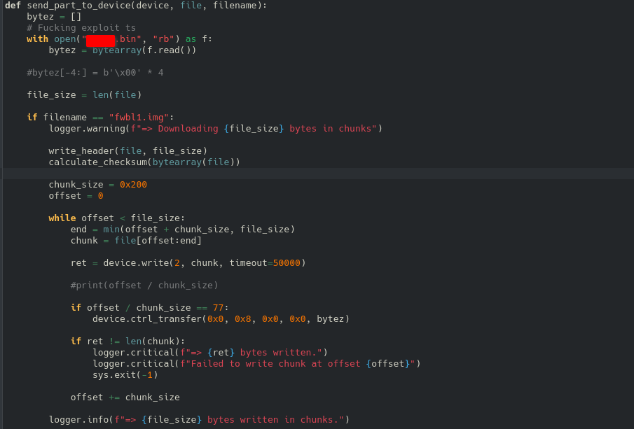
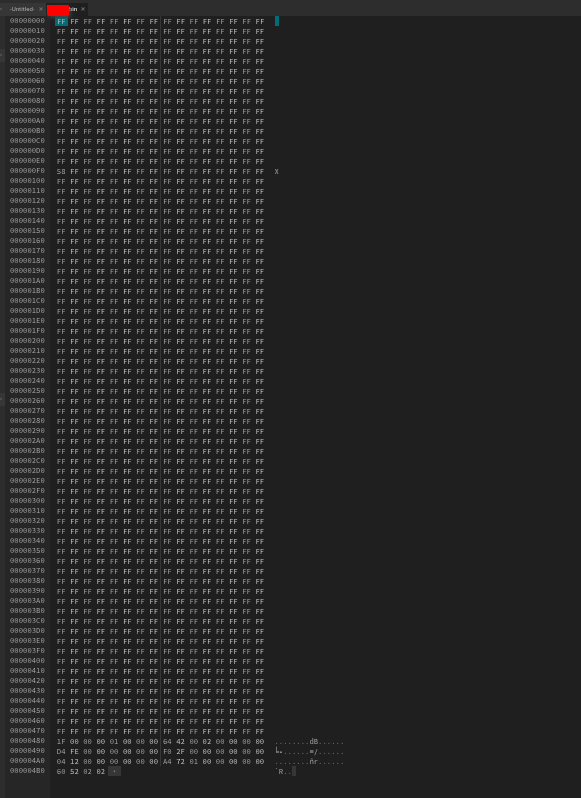

After this point, all of us got stuck and ended up deep in analysis paralysis trying to analyze encrypted binaries and messing around with the control transfer to no avail. We knew we needed David as he was the only one capable of understanding something of this capacity, so we reached out, and we were very fortunate to reach out as he was working on reverse engineering the Exynos iROM USB stack.

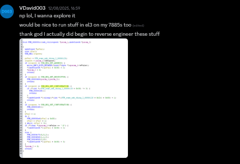

He seemed to understand the premise almost immediately, and after a couple of days of effort from him, I woke up to one of the greatest messages of all time.


And he was right. The exploit is extremely simple in retrospect, to the point that I can explain it in a single sentence.

The USB request handler in iROM does not check the length for GET_CONFIGURATION requests, allowing for iRAM / USB URAM to be leaked and resent, allowing for arbitrary code execution.

To be quite frank, something like this should've been caught right from the beginning; it only takes one good look at the USB standards to spot it.

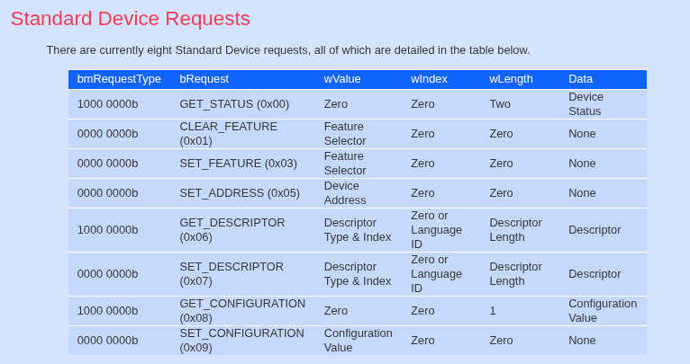
(thanks [beyondlogic.org](https://www.beyondlogic.org/usbnutshell/usb6.shtml))

None of the GET_CONFIGURATION requests in the packet dumps beyond what Windows does for enumeration are standard as they have wLength > 1.

For a slight technical view on WHY the control transfer gains ACE, we need to look at the USB struct used in iROM.

```c
typedef struct get_conf_usb_struct {
	uint32_t event_counter;
	uint32_t endpoint_event_thing;
	uint32_t trb_type;
	uint32_t unk;
	uint64_t xfercomplete_handler_ptr;
} get_conf_usb_struct;
```
(from [VDavid003/exynos-usbdl](https://github.com/VDavid003/exynos-usbdl/blob/master/exynos-usbdl.c))

A keen eye will already see what's up here, but for those that don't see it, xfercomplete_handler_ptr holds the address to the xfer complete handler. With our ability to dump that struct and modify it, we can modify that complete handler to point to an address we want and have iROM jump to it.

That paired with uploading a payload to the device gives us our ACE. Though you may be wondering, how can you upload a payload, doesn't it require verification and authentication on what is being sent, and to that I say YES BUT there is one condition.

Verification and authentication only happen when a binary is FULLY sent; we can spoof the size in the header to be much larger and have the device store the image and wait for the non-existent next part, which allows us to run the exploit.

Going back to the transfer we dumped.


We can see the tool sets the completion handler address to D4 FE, 0xFED4 when corrected for endianness, maxes out the event counter and sets other flags which do not matter for us. When jumped through there with those params, iROM decrypts the tool's payload and runs it. For us, we deviated from that approach. We just set the completion handler to the RX address for USB bulk transfers and incremented the event counter for stability, which got us executing our own payloads.

Seriously, thank you David for getting ACE for us; none of this would be possible without you.

Though now that we had ACE on Exynos 7870, what about Exynos 990?

## Porting to Exynos 990

Surprisingly, this was much easier said than done.

### SoC information

I think SoC information should be laid out before we continue; it plays an important part here, so here we go.

Exynos 990 is a piece of junk, a piece of junk that to the best of my knowledge (after snooping around in EL3 firmware) is codenamed 'Tokyo'. The most important part you must know is that it is a piece of junk though.

### Actually porting the exploit

#### Pain

The first snag we hit was what part of iRAM we should overwrite, which was easy enough to solve, doing multiple dumps and seeing the address where bytes start to deviate is where the struct starts (the event counter changes when USB events happen).

After that, we developed a simple payload to set PS_HOLD (iROM doesn't do this, hence the device automatically turns off if the power button isn't held) and an infinite loop. In theory, the device should never turn off and just stall.

Though after overwriting iRAM with values from 7870, we were displeased to find that instead of the device staying on, it simply crashed; even after playing around with the event counters, we always had the same result. We soon came to the conclusion that we were setting the wrong address for the completion handler.

#### Finding the right address

The first thing to run on Exynos platforms after iROM is BL1, the first bootloader. If you get the load address from this, that will be the address of the USB RX buffer, the address we need to overwrite the completion handler address with.

David was off to the races with our BL1 to find the right address, but while he was doing that, I asked my close friend [Roger Ortiz](https://r0rt1z2.com/) where BL1 would be loaded on a similar Exynos platform he was working on. Both people gave me the same answer at the same time. 0x02022000.


#### Back to pain

With the right address, you'd think from here on, it's straightforward, well yes, but no.

There was an improvement though, the device wasn't immediately crashing, but only stayed on for slightly longer before rebooting. Like the fools we were, we dismissed this, assuming it was still crashing, as the length of uptime was within the margin of error. This had us stumped for a good while to the point that David bought 2 Exynos 990 devices to help us, and in true David fashion, he cracked it immediately.

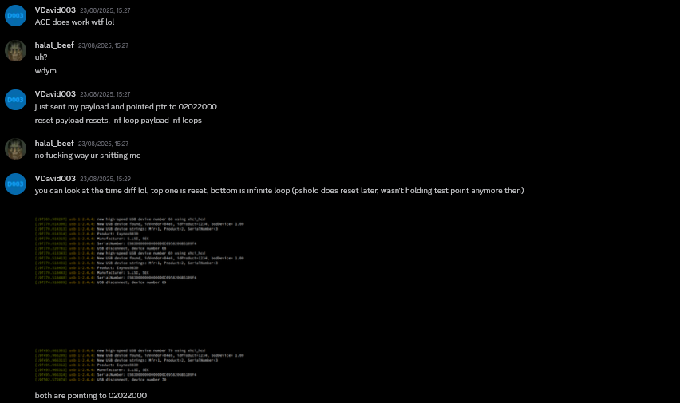

After that, he soon dumped the iROM and we could start having real fun.

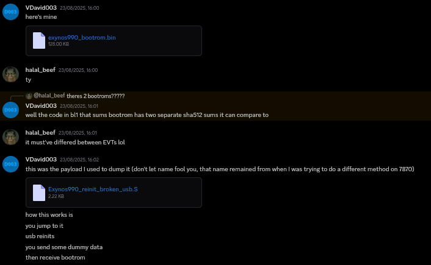

With ACE achieved, there was only one thing I wanted to do from here: boot my own bootloaders.

### Booting our own bootloaders

> [!WARNING]
> The code in here is terrible, we really didn't have a clue as to how iRAM was structured at this point.

#### BL1

This was pretty simple: our plan was to replicate the high-level BL1 load, check, auth and boot functions, send the stock BL1 and patch it live before jumping, probably one of the worst approaches out there but it worked.

The first point of order was getting a payload I was comfortable working with. David's iROM dumper was fine and in fact used as a base, but I didn't want to write absolutely everything in ASM as it is a bit convoluted.
In around 30m of work though, I had an initial PoC up based on his dumper working fine.

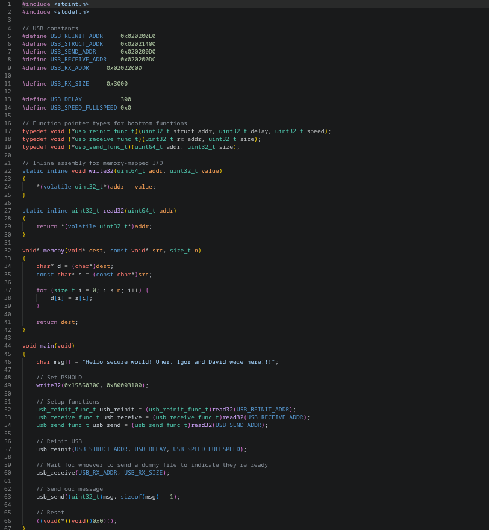

Now onto the harder part, replicating what iROM does to boot BL1.

This would have actually been simple, and in fact we had a replicated function ready.

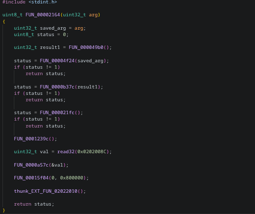

Unfortunately Igor and I trusted Ghidra's decompiler too much when replicating the function and spent many days and nights debugging why it wouldn't work, still to no avail. Igor and I were pretty burnt out at this point, so we took a break, but from here on, I had to work solo.

Let's take a look at Ghidra's output.

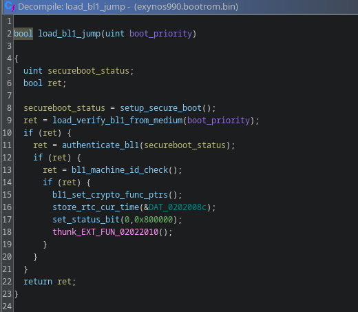

Seems fine, right? Wrong.

After painstakingly translating the ASM back into C, I soon came to realise that *one* line of the Ghidra decompiler was wrong, wrong enough to crash the device when we trusted its pseudocode.

Here's the corrected function.

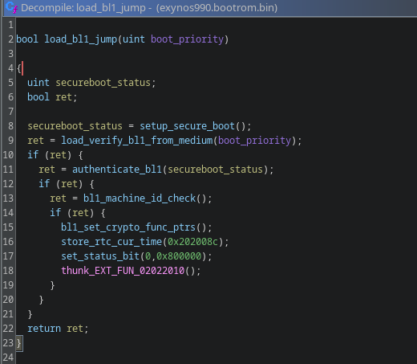

Can't see the difference? Look at line 16 in both functions. A simple misinterpreted argument caused us a lot of pain.

After transplanting the changes into our PoC, I had something ready.

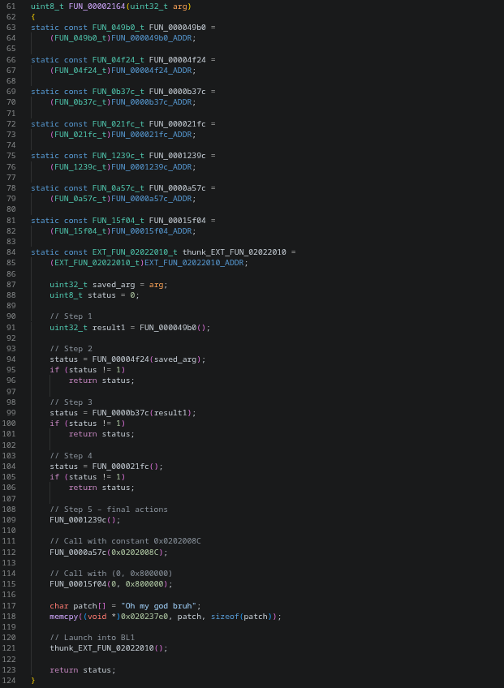

Code isn't pretty, but in theory it should work.

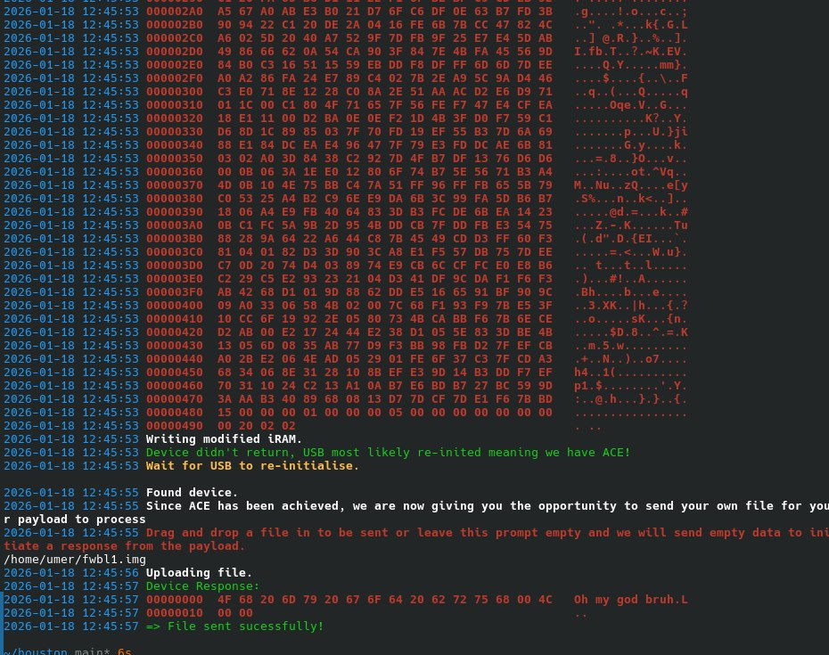

SUCCESS! We have successfully managed to boot a modified BL1 from this exploit, seeing this was like a dream come true.

From here, I simply tried booting the rest of the bootchain, to no avail??

It just randomly crashed after sending EPBL, though I had a sneaking suspicion already.

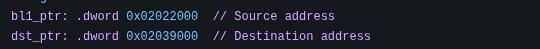
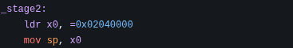

The addresses 0x02039000 and 0x020400000 seemed high enough in iRAM for it to be used by other pieces of firmware and overwrite our payload.

Since I had no idea where to place the payload, I did the next best thing and placed it right after the function pointer table. After doing that and turning off the stack protector (sorry, not sorry), we were now able to load EPBL.

#### EPBL

#### General information about EPBL

EPBL is the first more serious bit of EL3 firmware run on the device after BL1, as it sets up an initial SMC handler, sets up cores in PMU and prepares for DRAM initialisation; it is encrypted and decrypts itself on boot.

#### Dumping a decrypted EPBL

This was actually very simple; I chose a relatively simple function to hook in BL1 and redirected it back to my payload to be able to do some last-minute patches.

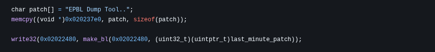

The last-minute patch function is fairly simple too.

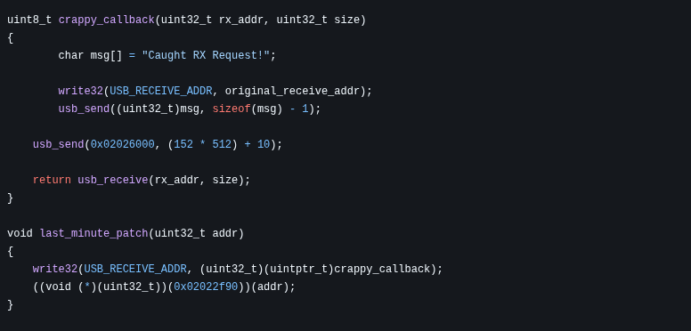

It just hooks the USB receive function pointer used by firmware to our payload, just to dump EPBL, as the function is called very late into EPBL, self-decryption is guaranteed to have already happened here. To no one's surprise, the hook worked immaculately and we now had a decrypted EPBL we can look at to plan our patches against.

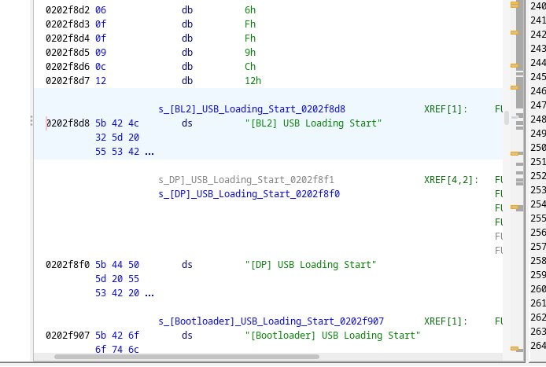

However, at this point I was far too lazy to patch EPBL and I took an alternative route instead for booting unsigned stuff beyond EPBL.

#### Don't trust me too much

A Root-Of-Trust (ROT) is how devices assert secure boot from beginning to end, making sure everything is authenticated; however, what if we just do what we did in BL1, send something completely stock to keep the ROT happy but change it at the last minute to be something else completely?

In security research, this type of attack is called a TOCTOU (Time-Of-Check to Time-Of-Use), and in our case, we can take advantage of the fact that we can intercept EPBL execution with hooks and edit images to our liking post-authentication.

#### The bootchain from EPBL onwards

EPBL loads BL2, verifies and authenticates it, after that it jumps to BL2, which does its usual rounds of initialising clocks, DRAM and other hardware, before calling into SMC (EPBL at this point) to continue boot.

EPBL then requests LK and EL3 Monitor to load from USB, authenticates it and jumps into it, completing the boot chain, LK does call into EL3 Monitor to load final trustzone bits but they're non-essential so I will leave them out here.

How does this tie into the TOCTOU I've mentioned? EPBL only checks the current image being loaded, there is nothing stopping us from doing what I mentioned above, loading a valid image, letting it authenticate, and changing it to what we want whilst loading the image after.

After recycling the same hooking logic for dumping a decrypted EPBL, I came up with this.

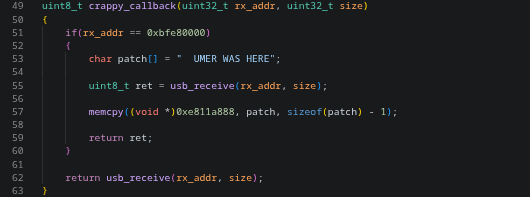

Should work, right? Well, no.

#### MMU Pain

One of the final pieces of Samsung's chain of bootloaders is EL3 Monitor. It is what it says it is on the tin, an EL3 Monitor. It sets up its own more complete SMC handler and handles EL3 operations from then on, but one of the things it does is enable MMU; this is very bad for us since when it did enable MMU, it marked the region we store our payload in as non-executable, meaning when EL3 Monitor called USB receive, our hook executed, and since it was a non-executable region, the device faulted.

I was far too tired to deal with this, so I did a simple change in my hook.

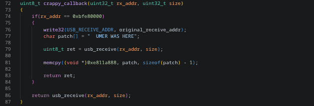

After this...

### A dream fully come true

I couldn't believe what my eyes were seeing.

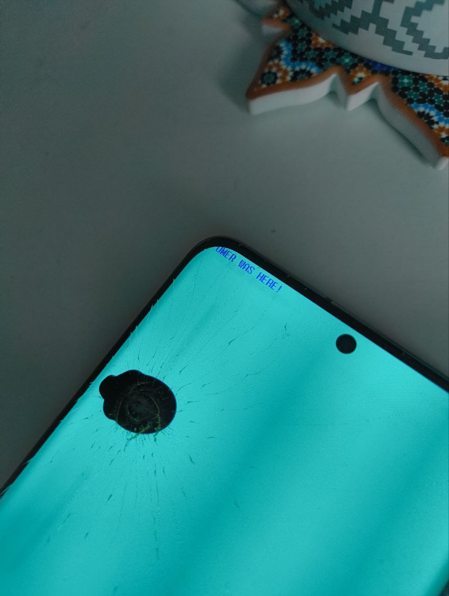

To say I was ecstatic was an understatement, but unfortunately this is where the fun ends; this post has gone on far too long and I think the projects I undertook with this device after this point deserve their own blog posts.